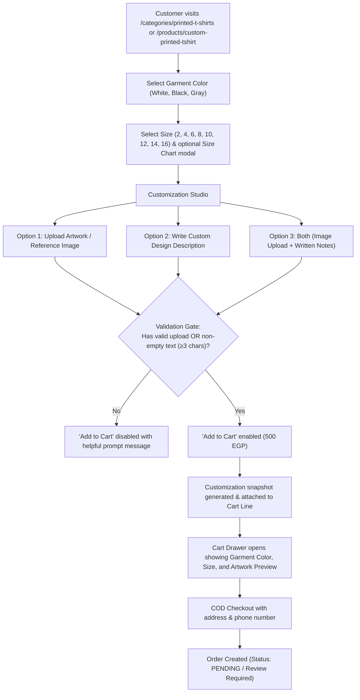
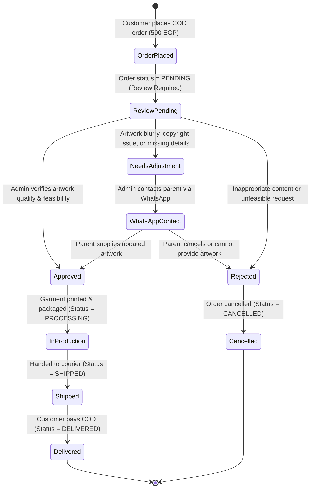

# Implementation Plan: Daisy Designs Custom Printed T-Shirts

**Category**: Printed T-Shirts (`printed-t-shirts`)  
**Base Garment**: Plain Children's T-Shirts (تيشيرت أطفال سادة)  
**Confirmed Unit Price**: **500 EGP**  
**Document Status**: Proposal & Architecture Plan (Strictly Planning Mode — No code/DB modifications executed)

---

## 1. Executive Summary & Confirmed Business Decisions

| Parameter | Confirmed Value | Architectural Notes |
| :--- | :--- | :--- |
| **Product Category** | Printed T-Shirts (`printed-t-shirts`) | Extends `STORE_CATEGORIES` in `src/lib/store-categories.ts`. Aliases: `t-shirts`, `tshirts`. |
| **Product Slug** | `custom-printed-tshirt` | Primary customized product in the apparel category. |
| **Unit Price** | **500 EGP** per T-shirt | Stored as integer `500`. Fixed price regardless of color or size. |
| **Garment Type** | Plain children's T-shirt | High-quality blank cotton T-shirt ready for custom print application. |
| **Available Colors** | **3 Confirmed Colors**: White (أبيض), Black (أسود), Gray (رمادي) | Rendered as interactive visual swatches with color borders and Arabic labels. |
| **Available Sizes** | **Children's Sizes 2 to 16** (from `D:\esssam\Size chart`) | Exact dimensions documented below. Full measurement diagram modal included. |
| **Customization Mode** | **Flexible Dual-Input (Upload OR Text OR Both)** | Customer can provide an image upload, a text description, or both. |
| **Submission Rule** | Proceed with **either** a valid upload **or** a non-empty description | `validUpload || trimmedText.length >= 3` unlocks the Add-to-Cart CTA. |
| **Artwork Expectation** | **Manual Review Required** (No instant auto-printing implied) | Storefront explicitly informs customer that artwork is subject to review prior to printing. |
| **Order Payment** | Cash on Delivery (COD) / Standard Checkout | Seamless integration with existing cart, line isolation, and checkout. |

---

## 2. Size Chart & Measurement Inventory

Exact measurements extracted directly from `D:\esssam\Size chart` without alteration or invention.

### 2.1 Primary Size Chart: Children's Short-Sleeve T-Shirt (تيشيرت الأطفال نص كم)
*Source: `D:\esssam\Size chart\WhatsApp Image 2026-10-17 at 2.46.25 AM (1).jpeg`*

| المقاس (Size) | العرض (Width / Chest cm) | الطول (Length / Shoulder to Hem cm) | الفئة العمرية التقريبية (Approx. Age) |
| :---: | :---: | :---: | :---: |
| **Size 2** | **32 cm** | **45 cm** | 1.5 – 2 Years |
| **Size 4** | **34 cm** | **47 cm** | 3 – 4 Years |
| **Size 6** | **36 cm** | **49 cm** | 5 – 6 Years |
| **Size 8** | **38 cm** | **52 cm** | 7 – 8 Years |
| **Size 10** | **40 cm** | **54 cm** | 9 – 10 Years |
| **Size 12** | **42 cm** | **56 cm** | 11 – 12 Years |
| **Size 14** | **44 cm** | **58 cm** | 13 – 14 Years |
| **Size 16** | **46 cm** | **60 cm** | 15 – 16 Years |

### 2.2 Secondary Size Chart: Standard / Adult T-Shirt (جدول مقاسات التيشيرت كم ونص كم)
*Source: `D:\esssam\Size chart\WhatsApp Image 2026-10-17 at 2.46.25 AM (2).jpeg`*  
*(Maintained in documentation for potential future expansion or teen/adult sizing upon client request)*

| المقاس (Size) | العرض (Width cm) | الطول (Length cm) |
| :---: | :---: | :---: |
| **Size S** | **50 cm** | **70 cm** |
| **Size M** | **52 cm** | **72 cm** |
| **Size L** | **54 cm** | **74 cm** |
| **Size XL** | **56 cm** | **76 cm** |
| **Size XXL** | **58 cm** | **78 cm** |

### 2.3 Measurement Guide Diagram Integration
*Source: `D:\esssam\Size chart\WhatsApp Image 2026-10-17 at 2.46.25 AM.jpeg`*
- **العرض (Chest Width)**: Measured horizontally across the chest from armpit seam to armpit seam.
- **الطول (Body Length)**: Measured vertically from the highest shoulder point next to the collar down to the bottom hem.
- **الكم (Sleeve)**: Short sleeve length from shoulder seam to sleeve cuff.
- **UI Integration**: An interactive "جدول المقاسات ودليل القياس" (Size Chart & Measurement Guide) button will open an accessible modal showing the visual diagram side-by-side with the table.

---

## 3. Product Page Architecture & Customer Flow

### 3.1 Step-by-Step Customer Journey


### 3.2 Product Page Component Layout (`src/components/tshirt-preview.tsx`)
1. **Interactive Garment Visualizer (Left Column / Main Gallery)**:
   - Dynamic plain T-shirt mockup reflecting the selected color (White `#FFFFFF`, Black `#1E1E1E`, Heather Gray `#9CA3AF`).
   - If a customer uploads an image, a scaled preview overlay is displayed on the chest area of the mockup so the parent can visualize placement.
   - Clear badge: "معاينة تقريبية — التصميم النهائي يخضع لمراجعة وتنسيق فريق العمل" (Approximate preview — Final design is reviewed and formatted by our team).

2. **Garment Configuration (Right Column / Purchase Sidebar)**:
   - **Color Selector**:
     - Circular color swatches with active ring indicator:
       - White: `bg-white border-2 border-slate-300 dark:border-neutral-700`
       - Black: `bg-neutral-900 border-2 border-slate-400`
       - Gray: `bg-neutral-400 border-2 border-slate-300`
     - Displays selected color label in Arabic (أبيض / أسود / رمادي).
   - **Size Selector**:
     - Modern pill grid for sizes: `2`, `4`, `6`, `8`, `10`, `12`, `14`, `16`.
     - Link button with ruler icon: "دليل المقاسات (Size Chart)" opening the measurement diagram modal.

3. **Customization Studio (Upload & Description Zone)**:
   - **Artwork Upload Dropzone (`custom_design_file`)**:
     - Drag-and-drop zone with cloud upload icon.
     - Supports JPEG, PNG, WebP up to 10MB.
     - Client-side thumbnail preview with image filename, resolution badge, and "حذف" (remove) / "تغيير" (replace) buttons.
     - Asynchronous upload to `POST /api/uploads/tshirt-artwork`, receiving a secure storage key (`private:tshirt_art_<uuid>.<ext>`).
   - **Design Description Field (`custom_design_text`)**:
     - Multi-line textarea (min 3 rows).
     - Placeholder: "اكتب وصف التصميم المطلوب، أو تفاصيل إضافية مثل اسم الطفل، ألوان مفضلة، أو مكان الطباعة..."
     - Character counter (0 / 500 characters).
   - **Notice & Expectation Banner**:
     - Subtle alert box with info icon:
       > **ملاحظة هامة**: لا تتم الطباعة آلياً بمجرد الطلب. يقوم فريق Daisy Designs بمراجعة التصميم المرفق أو الوصف للتأكد من جودة الصورة وتناسقها، وسنتواصل معكم لتأكيد الشكل النهائي قبل التنفيذ.

4. **Action & Pricing Footer**:
   - Price display: **500 ج.م** (شامل التيشيرت والطباعة).
   - Quantity stepper.
   - Primary CTA: "أضف إلى السلة" (Add to Cart).
     - Enabled if `hasValidUpload || trimmedText.length >= 3`.
     - Tooltip if disabled: "يرجى رفع تصميم أو كتابة وصف للطلب للمتابعة".

---

## 4. Secure Artwork Upload & Storage Architecture

### 4.1 Storage & Privacy Isolation
- Replicates and expands the proven security pattern from `src/lib/child-photo-storage.ts`.
- **Private Directory**: `storage/private_uploads/tshirt_artwork/` located strictly outside the public web root (`public/`). Files are **never** accessible directly via static URL paths.
- **Cryptographic Naming**: Filenames hashed with UUID v4: `tshirt_art_${randomUUID()}.${ext}`.
- **Storage Key**: `private:tshirt_art_${uuid}.${ext}`.

### 4.2 Server-Side Validation Pipeline (`POST /api/uploads/tshirt-artwork`)
1. **MIME Type Whitelist**: Strictly `image/jpeg`, `image/png`, `image/webp`. Reject executable, vector, or script payloads (`.svg`, `.html`, `.exe`).
2. **Magic Bytes Header Verification**:
   - JPEG: `0xFF 0xD8 0xFF`
   - PNG: `0x89 0x50 0x4E 0x47 0x0D 0x0A 0x1A 0x0A`
   - WebP: `0x52 0x49 0x46 0x46 ... 0x57 0x45 0x42 0x50`
3. **Payload Size Limit**: Hard ceiling of **10 MB** (to support high-resolution artwork suitable for DTF/apparel printing).
4. **Resolution Validation**:
   - Minimum dimension check: Extract width/height.
   - If `< 600px`, reject with user-friendly error: "دقة الصورة منخفضة جداً للطباعة، يرجى رفع ملف بدقة أعلى".
   - If `>= 800px`, accept as high quality.
5. **Metadata Sanitization**:
   - Strip all EXIF, GPS location coordinates, and camera device serial numbers from JPEG and PNG buffers prior to writing to disk.

### 4.3 Retention & Lifecycle Management
- **Orphan Cleanup**: Unattached uploads (cart abandonments) older than 24 hours purged via periodic task or maintenance check.
- **Order Retention**: Artwork linked to completed orders retained for **30 days** post-delivery for customer service/reprint inquiries, then securely deleted.

---

## 5. Cart, Checkout & Data Pipeline Integration

### 5.1 Customization Data Schema
```typescript
export type TShirtCustomization = {
  garment_color: "white" | "black" | "gray";
  garment_size: "2" | "4" | "6" | "8" | "10" | "12" | "14" | "16";
  custom_design_file?: string;      // e.g. "private:tshirt_art_550e8400-e29b-41d4-a716-446655440000.png"
  custom_design_filename?: string;  // e.g. "my-superhero-drawing.png"
  custom_design_text?: string;      // e.g. "لوجو باتمان أصفر في المنتصف مع كتابة كابتن كريم"
  notes?: string;                   // Extra printing instructions
};
```

### 5.2 Cart Line Isolation (`src/lib/cart-line-state.ts`)
- Uses `cartIdentity({ productId, variantId, customization })`.
- Any difference in `garment_color`, `garment_size`, `custom_design_file`, or `custom_design_text` yields a distinct hash.
- Example: A parent ordering one White Size 6 with a Dino drawing and one Black Size 8 with a Space sketch gets **two distinct, unmerged cart lines**, each priced at 500 EGP.

### 5.3 Order Persistence & Database Schema Compatibility
- The existing Prisma schema supports arbitrary JSON in `OrderItem.customization` and `OrderItem.productSnapshot`:
  ```prisma
  model OrderItem {
    id              String          @id @default(cuid())
    productName     String
    productSku      String
    productSnapshot Json
    customization   Json?
    quantity        Int
    unitPrice       Int             // 500
    ...
  }
  ```
- **Zero Prisma migrations required**: No database schema changes, table alterations, or migrations needed.

---

## 6. Store Review, Approval & Unfulfillable Request Protocol

Because custom apparel printing incurs blank garment and consumable costs, orders cannot be printed blindly without validation.



### 6.1 Admin Order Management & Secure Artwork Retrieval
- **Authorized Secure Endpoint**: `GET /api/admin/orders/[id]/tshirt-artwork`
  - Protected by `isAdmin()` session guard.
  - Streams the decrypted/sanitized high-res image directly to the store manager.
- **Admin Orders Dashboard (`src/app/admin/orders`)**:
  - T-Shirt orders flagged with: `تيشيرت مخصص (بحاجة للمراجعة)`.
  - Expanding order details reveals:
    - Selected Garment: Color (White/Black/Gray) + Size (2–16).
    - Artwork Preview: Thumbnail + "تحميل التصميم عالي الدقة للطباعة" (Download Hi-Res for Print).
    - Written Request: Full design prompt text.
    - Customer Info: Name, Governorates, Phone Number with 1-click WhatsApp shortcut: `https://wa.me/20${cleanPhone}`.

### 6.2 Protocol for Unfulfillable Requests
1. **Low Resolution / Unclear Artwork**:
   - Store operator clicks the WhatsApp shortcut: "أهلاً بحضرتك من متجر Daisy Designs، بخصوص طلب التيشيرت المخصص رقم #...، الصورة المرفقة دقتها منخفضة للطباعة. هل يمكنك إرسال النسخة الأصلية لمساعدتك في تجهيزه؟"
2. **Missing Specifications**:
   - If customer provided a description only without exact graphics, team sends a quick mockup proof on WhatsApp for customer approval before printing.
3. **Cancellation & Rejection**:
   - If customer cannot be reached after 3 attempts or declines the proof, admin sets order status to `CANCELLED` via `PATCH /api/admin/orders/[id]` with reason `UNFULFILLABLE_CUSTOMIZATION`. No payment was collected (COD).

---

## 7. Phased Implementation Roadmap (GSD Atomic Steps)

Execution will proceed strictly one atomic phase at a time following the GSD and Ralph Loop rules once user approval is granted.

### Phase 1: Static Assets & Data Fixture Setup
- [ ] Inspect existing T-shirt mockups or prepare clean base images for White, Black, and Gray garments in `public/products/t-shirts/`.
- [ ] Create `src/data/tshirt-product.json` with official product definition:
  - Name: "تيشيرت أطفال بطباعة مخصصة" / "Custom Printed Children's T-Shirt"
  - Price: 500 EGP (strictly 500)
  - Category: `printed-t-shirts`
  - Colors: White, Black, Gray
  - Sizes: 2, 4, 6, 8, 10, 12, 14, 16
- [ ] Create `scripts/import-tshirt-product.ts` (safe local sync only, supporting `--dry-run` and `--apply`).

### Phase 2: Private Artwork Storage Engine & Upload API
- [ ] Create `src/lib/tshirt-artwork-storage.ts`:
  - Target directory: `storage/private_uploads/tshirt_artwork/`
  - Magic byte verification (JPEG, PNG, WebP)
  - EXIF / metadata stripper
  - Minimum resolution verification (600×600 px min, 800×800 px recommended)
  - Filename hashing and path resolution
- [ ] Implement `POST /api/uploads/tshirt-artwork`:
  - Multipart upload route with 10MB limit and detailed error responses in Arabic and English.
- [ ] Implement `GET /api/admin/orders/[id]/tshirt-artwork`:
  - Authenticated admin route to stream the full-resolution artwork file.

### Phase 3: Customization Validation & Formatter Extensions
- [ ] Update `src/lib/customization-validation.ts`:
  - Add validator for T-shirt customization:
    - `garment_color` in `["white", "black", "gray"]`
    - `garment_size` in `["2", "4", "6", "8", "10", "12", "14", "16"]`
    - At least one of `custom_design_file` (valid `private:tshirt_art_...` token) OR `custom_design_text` (trimmed string length ≥ 3).
- [ ] Update `src/lib/customization-formatter.ts`:
  - Add field labels in Arabic and English (`garment_color`, `garment_size`, `custom_design_file`, `custom_design_text`).
  - Add color names in Arabic (أبيض، أسود، رمادي) and secure artwork file badges.
- [ ] Update `src/lib/i18n/messages.ts` with all bilingual UI strings.

### Phase 4: T-Shirt Studio Preview & Customizer Component
- [ ] Create `src/components/tshirt-preview.tsx`:
  - Dynamic mockup viewer showing garment in selected color.
  - Visual color selector (White, Black, Gray).
  - Size selector (2–16) with interactive Size Chart modal showing the WhatsApp chart table and measurement diagram.
  - Dual customization zone:
    - Drag & drop upload zone with client preview & remove button.
    - Textarea for written design requests.
  - Clear customer expectation notice regarding store review before printing.
  - Add to Cart button bound to validation state.
- [ ] Add tailored styles in `src/app/globals.css` with dark & light mode support.

### Phase 5: Routing & Storefront Catalog Integration
- [ ] Update `src/app/categories/[slug]/page.tsx`:
  - Handle `slug === "printed-t-shirts"` (and aliases `t-shirts`, `tshirts`) by rendering `TShirtPreview`.
- [ ] Update `src/app/products/[slug]/page.tsx`:
  - Route `custom-printed-tshirt` (and aliases) to `TShirtPreview`.
- [ ] Update `src/components/products-catalog-client.tsx` and category cards to highlight the new 500 EGP custom T-shirt.

### Phase 6: Admin Order Review UI & WhatsApp Action Integration
- [ ] Update `src/app/admin/orders/page.tsx` or create order detail view:
  - Display custom T-shirt details (color, size, design text, artwork download link).
  - Add 1-click WhatsApp contact button with pre-filled message template.
  - Support status transitions (PENDING -> CONFIRMED -> PROCESSING -> SHIPPED -> DELIVERED / CANCELLED).

### Phase 7: Verification Suite & Continuous Verification (Ralph Loop)
- [ ] Create automated test suite `tests/tshirt-product.test.ts`:
  - Price verification (strictly 500 EGP).
  - Size chart values test (asserts exact cm for sizes 2–16).
  - Validation test: passes with image only, passes with text only, passes with both, fails with neither.
  - Upload security tests (magic bytes, size ceiling, path traversal protection).
  - Cart line isolation tests.
- [ ] Run full project verification:
  - `npx tsc --noEmit` (0 errors)
  - `npm run lint` (0 errors)
  - `npm test` (all tests pass)
  - `npm run build` (clean compilation)
- [ ] Conduct browser inspection via Playwright across desktop & mobile viewports in light and dark modes.

---

## 8. Remaining Decisions & Unresolved Questions for Store Owner

The following items are documented for store owner alignment before or during implementation:

1. **Available Stock Inventory by SKU**:
   - What initial inventory should be configured per color & size combination? (3 colors × 8 sizes = 24 SKUs). Or should blank garments have a shared bulk pool (e.g. 100 units)?
2. **Print Placement & Area Limitations**:
   - Is printing strictly single-sided (Center Chest / A4 area), or will customers be allowed to request Back or Pocket placement?
   - Is there a maximum print area (e.g., 20×25 cm for small children's sizes)?
3. **Printing Technique & Fabric Restrictions**:
   - What printing technology is utilized (DTF, Vinyl heat press, Screen print, Sublimation)?
   - Are there specific garment fabric details to state (e.g., 100% Egyptian Cotton)?
4. **Adult / Standard Sizes (S, M, L, XL, XXL)**:
   - The size chart folder contains an adult chart (`WhatsApp Image 2026-10-17 at 2.46.25 AM (2).jpeg`). Should adult sizes be offered alongside children's sizes at the same 500 EGP price, or kept for a future separate release?
5. **Turnaround & Production Time SLA**:
   - What is the expected preparation time before shipping? (e.g., 2–3 business days for custom printing vs 1 day for storybooks).
6. **Customer Notification Preferences**:
   - Should proof confirmations be handled purely over WhatsApp by the store admin, or should an automated email status notification also be triggered?

---

## 9. Phase 30: Frictionless Purchase Flow & High-Conversion UX Execution Plan

### Step 1: Egyptian Governorates Dropdown & Checkout Streamlining
- Replace `<input name="governorate" />` in `src/app/checkout/page.tsx` with a curated `<select>` of all 27 Egyptian governorates with localized names and regional delivery estimates (القاهرة، الجيزة، الإسكندرية، ...).
- Add real-time phone number format detection (`010`, `011`, `012`, `015`) and a visual validation indicator.
- Add an optional courier note / WhatsApp backup phone field.
- Highlight Cash on Delivery (COD) safety badge and delivery guarantee.

### Step 2: Mobile Sticky Purchase Bar
- Create or update responsive product viewers (`StoryBookPreview`, `StickersPreview`, `TShirtPreview`, `RewardCardsPreview`) to feature a sticky bottom checkout bar on mobile viewports (< 768px).
- Provide dual action:
  - `اشتري الآن (دفع عند الاستلام)` -> Adds to cart and redirects immediately to `/checkout`.
  - `إضافة إلى السلة` -> Adds to cart and shows the slide-over cart drawer with haptic feedback.
- If required fields (e.g., child photo) are missing, smoothly scroll and highlight the required input with friendly Egyptian Arabic guidance.

### Step 3: Cart Drawer Transparency & Trust
- Add dynamic free-shipping progress tracker in `CartDrawer`.
- Display high-contrast total with COD badge.
- Ensure 44×44px minimum tap zones for steppers and removal.

### Step 4: WhatsApp Post-Purchase Confirmation
- On `/checkout/success`, provide a prominent 1-click WhatsApp button with pre-filled order confirmation message to contact Daisy Designs directly.

### Step 5: Verification & Ralph Loop
- Full lint (`npm run lint`), typecheck (`tsc --noEmit`), unit test suite (90/90 pass), and production build (41/41 routes clean).
- Browser inspection and visual verification on mobile viewports.


---

## 9. Phase 32: Adult & Children Sizes Expansion Plan

### Step 1: Data Model & Customization Validation
- Update `src/data/tshirt-product.json`:
  - Add adult sizes (S, M, L, XL, XXL) with verified measurements (Width: 50, 52, 54, 56, 58 cm; Length: 70, 72, 74, 76, 78 cm).
  - Update product & category copywriting to reflect both Adults and Children ("كبار وأطفال").
- Update `src/lib/customization-validation.ts`:
  - Expand `VALID_TSHIRT_SIZES` to accept `["2", "4", "6", "8", "10", "12", "14", "16", "S", "M", "L", "XL", "XXL"]` with case-insensitive normalization.

### Step 2: Customizer Component UI & Segmented Size Selector
- Update `src/components/tshirt-preview.tsx`:
  - Add segmented control / category selector: `مقاسات الكبار (S - XXL)` and `مقاسات الأطفال (سن ٢ - ١٦)`.
  - Dynamically render relevant size pills with their exact width in centimeters.
  - Update copywriting, guarantees, and breadcrumbs to reflect both Adults and Children.

### Step 3: Size Guide Modal Enhancement
- Update `src/components/tshirt-size-guide-modal.tsx`:
  - Export `ADULT_SIZES` alongside `CHILDREN_SIZES`.
  - Add tabs for Adults table (S to XXL with `adult-size-chart.jpeg`), Children table (2 to 16 with `children-size-chart.jpeg`), and the measurement diagram.

### Step 4: Catalog, Marquee, Storefront & Admin Table Updates
- Update `src/app/products/page.tsx` and filter pills to display "تيشيرتات (كبار وأطفال)" and highlight comprehensive sizing.
- Update `src/lib/store-categories.ts`, `src/lib/ensure-catalog-product.ts`, and `src/lib/i18n/messages.ts`.
- Update `src/components/admin-orders-table.tsx` to display whether the size is for adults or children.

### Step 5: Test Suite & Ralph Loop Verification
- Update `tests/tshirt-product.test.ts` to test all 13 valid sizes (both children and adults) and ensure invalid sizes are properly rejected.
- Execute full Ralph Loop verification: typecheck, lint, 90/90 tests, 41/41 build.


---

## 10. Implementation Plan: Category Rename to "تيكت وليبل وميدالية" & Keychain Products Integration

### Step 1: Update Category Metadata Across the Store
- `src/lib/store-categories.ts`:
  - `arabicName: "تيكت وليبل وميدالية"`
  - `name: "Tickets, Labels & Keychains"`
  - Update tagline and description to mention personalized acrylic keychains.
- `src/components/category-card.tsx`:
  - Update `SHORT_TAGLINES` for `stickers`.
- `src/data/stickers-product.json`:
  - Update `category.arabicName` to `"تيكت وليبل وميدالية"` and `category.name` to `"Tickets, Labels & Keychains"`.
- `src/lib/ensure-catalog-product.ts`:
  - Update `stickers` category name.
- `src/components/stickers-catalog-client.tsx` & `src/components/stickers-preview.tsx`:
  - Update header labels.
- `src/app/products/page.tsx`:
  - Update filter label and product card category badges.

### Step 2: Database Synchronization
- Run script to update `Category` record in PostgreSQL (`arabicName: "تيكت وليبل وميدالية"`, `name: "Tickets, Labels & Keychains"`).
- Upsert the 3 keychain products with stock, pricing (70 EGP), images, and customization fields.

### Step 3: Catalog & Storefront Integration
- Add the 3 keychain products to `src/app/products/page.tsx` with high-resolution imagery and direct purchase flow.
- Ensure `/products/[slug]` correctly displays and customizes each keychain.

### Step 4: Verification Loop
- Run tests (`store-categories.test.ts`, `business-catalog.test.ts`).
- Execute Ralph Loop (`tsc`, `lint`, `test`, `build`).
