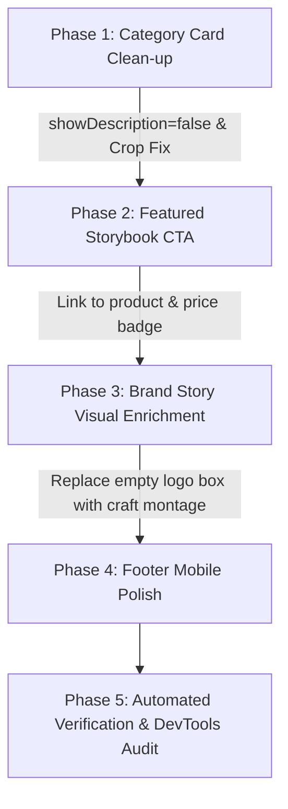

# Daisy Designs — Homepage UX/UI Review & Improvement Plan

**Project**: Daisy Designs Storefront (`D:\esssam\store`)  
**Evaluation Scope**: Homepage (`src/app/page.tsx`), Navigation, Visual Hierarchy, Typography, Responsiveness, Conversion Paths  
**Audience**: Egyptian & Arab parents seeking premium personalized children's products  
**Status**: Planning & Review Only (Zero source code modifications until approved)  

---

## 1. Executive Summary

A comprehensive, read-only UX/UI evaluation was conducted on the Daisy Designs homepage across both desktop (1280×800) and mobile (390×844) viewports in both Light and Dark modes.

The brand identity, typography, warm editorial tone, and product photography are strong and distinctive. Following the recent implementation of the panoramic hero banner and color restorations, the homepage feels cohesive and authentic. 

However, several high-impact UX frictions and conversion bottlenecks were directly identified in the code and rendered interface:
1. **Brand Story Dead Zone**: Section `.daisy-personalization` dedicates a massive 550×550px square to an empty void with a single static logo, creating a cold, stark visual dead-end.
2. **Featured Product CTA Disconnect**: The flagship storybook section showcases the 200 EGP "First Year at School" product, but its primary action button links to `/about` ("اعرف قصتنا") rather than allowing the customer to customize or buy the book.
3. **Category Card Text Duplication**: Category cards render both `tagline` and `description` simultaneously, forcing repetitive text (e.g., repeating water-resistant stickers description twice).
4. **Sticker Image Cropping**: The horizontal sticker sheet in the category card has its top and bottom text clipped by the portrait container frame.
5. **Footer Mobile Safe-Area & Contrast**: Legal links in the footer bottom bar get cramped on mobile viewports.

---

## 2. What Is Already Working Well (Must Remain Unchanged)

To preserve the brand equity and stability of the platform, the following elements are verified as effective and **must not be altered**:
1. **Panoramic Hero Showcase**: The newly installed `hero.jpeg` banner cleanly displays the entire product universe (stories, stickers, t-shirts, puzzles) in one high-resolution, luxury frame.
2. **Store Category Architecture**: The 4 confirmed categories (**Stickers**, **Reward Cards**, **Customized Stories**, **Printed Children's T-Shirts**) are logically structured with bilingual routing (`/categories/[slug]`).
3. **Heading & Semantic Hierarchy**: Correct HTML semantic outline (`h1` sr-only $\rightarrow$ `h2` section headers $\rightarrow$ `h3` category card titles).
4. **Bilingual RTL/LTR Architecture**: Full mirrored layout support with dynamic arrow switching (`ArrowLeft` vs `ArrowRight`, `UpArrow`).
5. **Theme Engine**: Smooth dark/light mode toggle with CSS variables and zero flash of unstyled content.
6. **Checkout & Product Stability**: The approved Children's T-shirt product page, COD checkout, cart line isolation, and 89 automated tests remain completely intact and stable.

---

## 3. Top 5 Highest-Value Improvements (Ranked by Impact)

### Priority 1: Transform the Brand Story Section Dead Zone (`.daisy-personalization`)
- **Directly Observed Issue**: 
  In `src/app/page.tsx` (lines 72–104), `.daisy-personalization__visual` renders a giant square container with `border: 12px solid var(--surface-panel)` containing only `<BrandLogo variant="lockup" />` and a tiny circular badge `"صنع لهم"`.
  In both Light and Dark mode, this creates an enormous empty box (~550×550px) that looks like a missing photo or broken placeholder. The brand logo has already been displayed in the header and hero banner.
- **Root Cause**:
  The CSS (`.daisy-personalization__visual`) and component structure treat the visual side of the 3-step personalization guide as a logo billboard rather than showing the craft of personalization.
- **Proposed Solution**:
  Replace the stark logo-only box with a warm, authentic product craft presentation using existing product imagery (e.g., an authentic montage of the personalized storybook cover with the child photo, custom name stickers, and printed T-shirt) OR an elegant editorial layout highlighting the 3 personalization steps with subtle material texture.
- **Before / After**:
  - *Before*: An empty dark/light 550px square containing only the brand logo.
  - *After*: A rich visual showing a personalized storybook and custom stickers with a child's name, proving the promise of "كل قطعة تبدأ باسم".
- **Relevant Files**:
  - `src/app/page.tsx` (lines 72–81)
  - `src/app/globals.css` (lines 774–812, 2927–2945, 5553–5580)
- **Risk Assessment**:
  Zero risk to cart, checkout, or database. Purely layout and presentation.

---

### Priority 2: Direct Customization Path for Featured Storybook (`.daisy-story`)
- **Directly Observed Issue**:
  In `src/app/page.tsx` (lines 106–130), the section features the high-resolution cover of **"عز وأول سنة في المدرسة"** (Customized Story, 200 EGP).
  However, the button at the bottom says `اعرف قصتنا` and links to `/about` (`<Link href="/about" className="daisy-text-link">`).
- **Root Cause**:
  The section was originally conceived as an editorial about-story section rather than a commercial product feature.
- **Proposed Solution**:
  1. Add a primary high-intent action button: `خصصي قصة لطفلك` linking directly to `/products/first-year-at-school` (or `/categories/customized-stories`).
  2. Include a subtle price/product badge: `قصة مطبوعة مخصصة بالاسم والصورة — ٢٠٠ ج.م`.
  3. Keep a secondary text link for customers who actually want to read the brand story: `اعرف قصتنا ←` (`/about`).
- **Before / After**:
  - *Before*: Customers captivated by the storybook click the button and land on the generic text-heavy `/about` page, interrupting the purchase flow.
  - *After*: Customers click `خصصي قصة لطفلك` and land directly on the storybook customization page where they can enter their child's name, gender, and upload their photo.
- **Relevant Files**:
  - `src/app/page.tsx` (lines 106–130)
  - `src/lib/i18n/messages.ts` (translation keys for CTA)
- **Risk Assessment**:
  Zero risk to existing order schema. Directly increases storybook conversion.

---

### Priority 3: Eliminate Redundant Category Card Descriptions
- **Directly Observed Issue**:
  In `src/components/category-card.tsx` (lines 106–115), each card renders both `tagline` and `description`:
  ```tsx
  <p className="store-category-card__tagline">{tagline}</p>
  {showDescription && <p className="store-category-card__description">{description}</p>}
  ```
  On the homepage, `showDescription={true}` causes both to render simultaneously.
  For Stickers:
  - *Tagline*: `"ملصقات مقاومة للماء للدفاتر والحقائب وزجاجات المياه"`
  - *Description*: `"استيكرات عالية الجودة ومقاومة للماء مخصصة للأدوات المدرسية، الدفاتر، الحقائب، وزجاجات المياه..."`
  For T-Shirts:
  - *Tagline*: `"تيشيرتات أطفال سادة مخصصة بطباعة تصميمك الخاص على منتصف الصدر"`
  - *Description*: `"تيشيرتات أطفال قطن سادة عالية الجودة، مخصصة بطباعة رسمتك أو فكرتك على منتصف الصدر..."`
- **Root Cause**:
  `tagline` and `description` have overlapping copy. Stacking them both creates repetitive reading and pushes the card height beyond optimal proportions.
- **Proposed Solution**:
  On the homepage category grid, set `showDescription={false}` or render only the single, punchiest copy line per card. Let the category page (`/categories/[slug]`) hold the detailed multi-sentence description.
- **Before / After**:
  - *Before*: Category cards are vertically bloated with redundant text repeating the exact same points twice.
  - *After*: Sleek, consistent, luxury cards with clean typography and balanced heights across all 4 cards.
- **Relevant Files**:
  - `src/app/page.tsx` (line 65: pass `showDescription={false}`)
  - `src/components/category-card.tsx`
- **Risk Assessment**:
  Zero risk. Clean visual enhancement.

---

### Priority 4: Fix Sticker Category Card Image Framing & Cropping
- **Directly Observed Issue**:
  The cover image for Stickers (`/products/stickers/sticker-01-kpop-demon-hunters.jpeg`) is a horizontal sheet (aspect ratio ~1.6:1). The card container enforces a portrait ratio (`aspect-ratio: 4 / 4.7`) with `object-fit: cover`.
  This crops the top and bottom of the sticker sheet, cutting through the child's name ("Malak Khaled") and leaving an awkward sliced edge.
- **Proposed Solution**:
  1. Fine-tune `.store-category-card__cover-image` for sticker items with `object-position: center 25%` or subtle inset padding.
  2. Or use a composite thumbnail displaying the sticker in natural placement without cutting text.
- **Before / After**:
  - *Before*: Cut-off text on the sticker cover gives an accidental, unpolished feel.
  - *After*: Complete sticker showcase cleanly framed inside the card.
- **Relevant Files**:
  - `src/app/globals.css` (`.store-category-card__cover-image`)
- **Risk Assessment**:
  Pure CSS refinement.

---

### Priority 5: Footer & Bottom Bar Mobile Polish
- **Directly Observed Issue**:
  In `.daisy-footer`:
  1. The bottom legal row (`.daisy-footer__legal`) houses 3 items (`© 2026 DAISY DESIGNS`, `صُنع بحب في مصر`, and `الخصوصية والشروط`). On viewports under 400px, the Arabic text gets squeezed against the edge.
  2. The background monogram watermark in dark mode has almost 0 visibility (`opacity: .04`).
- **Proposed Solution**:
  1. Add responsive wrapping (`flex-wrap: wrap; gap: 12px; justify-content: space-between;`) on mobile viewports so legal links remain comfortably clickable (minimum 44px tap target).
  2. Adjust watermark opacity to a subtle but visible `0.08` in dark mode.
- **Before / After**:
  - *Before*: Legal links touch the left edge of mobile screens.
  - *After*: Well-spaced, balanced mobile footer that respects device safe areas.
- **Relevant Files**:
  - `src/app/globals.css` (footer styles)
- **Risk Assessment**:
  Zero functional risk.

---

## 4. Implementation Phasing & Acceptance Criteria

When approved, changes will be executed atomically in the following phases:



### Acceptance Criteria
1. **Category Cards**: All 4 cards have equalized heights, zero duplicate descriptions, and clean image framing without text clipping.
2. **Featured Storybook**: Features a clear primary button directing to `/products/first-year-at-school` with price visibility ("٢٠٠ ج.م"), plus a secondary link to `/about`.
3. **Brand Story (`.daisy-personalization`)**: The visual column displays an authentic craft/product showcase instead of an empty stark logo box.
4. **Mobile Usability**: All interactive buttons and links maintain $\ge 44\times 44\text{px}$ touch targets with no horizontal overflow.
5. **Stability & Regressions**: 89/89 automated tests in `npm test` continue to pass; `tsc --noEmit` produces 0 errors.

