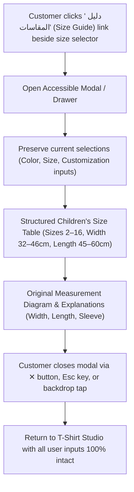
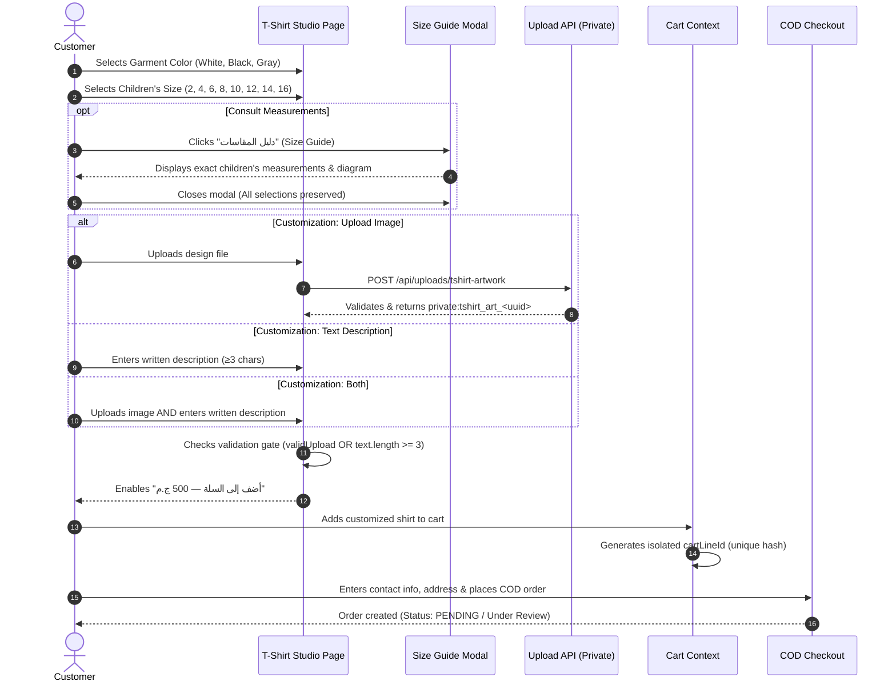
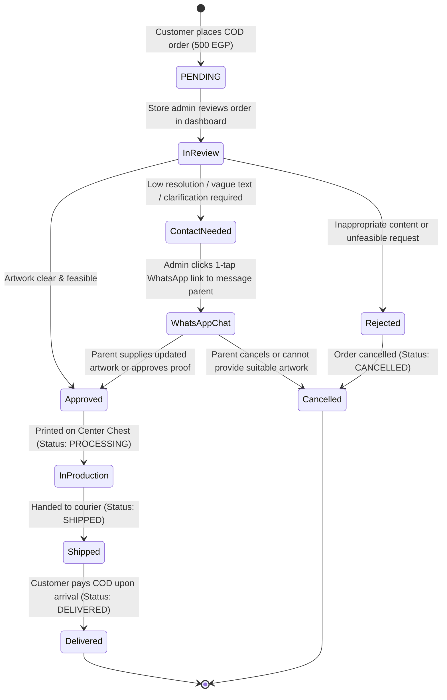

# Implementation Plan: Daisy Designs Custom Printed Children's T-Shirts

> [!IMPORTANT]
> **Planning-Only Mode**: This document is strictly an implementation and architecture plan. **No source code, test files, configuration files, planning documents (`PLAN.md`, `SPEC.md`, `TODO.md`), product records, or database tables have been modified**. No migrations or seed scripts have been executed. All existing implementations (Reward Cards, Stickers, and Customized Storybooks) remain 100% untouched.

---

## 1. Goal Description

Implement a brand-standard, secure **Custom Printed Children's T-Shirts** product line for Daisy Designs (`D:\esssam\store`). The product is strictly for **Children ONLY** (تيشيرت أطفال سادة), offered in three confirmed colors (**White**, **Black**, and **Gray**) across eight children's sizes (**2, 4, 6, 8, 10, 12, 14, 16**) at a confirmed uniform price of **500 EGP**. Print placement is strictly **Center Chest only**, with a production preparation time of **2–3 business days** before shipping.

The feature provides an accessible, responsive **Size Guide modal/drawer** directly beside the size selector based exclusively on the original children's size chart and measurement diagram in `D:\esssam\Size chart`. Customization is flexible (upload image, text description, or both) with logical OR server-side validation, private artwork storage, cart line isolation, and an administrator review workflow via manual WhatsApp communication.

---

## 2. Confirmed Business Decisions & Specifications

| Parameter | Confirmed Value | Architectural & Functional Specification |
| :--- | :--- | :--- |
| **Product Category** | Printed T-Shirts (`printed-t-shirts`) | Extends `STORE_CATEGORIES` in `src/lib/store-categories.ts`. Aliases: `t-shirts`, `tshirts`. |
| **Product Slug** | `custom-printed-tshirt` | Dedicated customized children's apparel product. |
| **Target Audience** | **Children ONLY (أطفال فقط)** | All adult sizing, adult tabs, and adult options are strictly excluded. |
| **Unit Price** | **500 EGP** per T-shirt | Stored as integer `500`. Fixed uniform price across all colors and sizes. |
| **Garment Colors** | **3 Confirmed Colors**: White, Black, Gray | White (`#FFFFFF`), Black (`#1E1E1E`), Gray (`#9CA3AF`) visual swatches with active ring indicator. |
| **Available Sizes** | **Children's Sizes 2 to 16** | Exact sizes: `2`, `4`, `6`, `8`, `10`, `12`, `14`, `16` directly from source chart. |
| **Print Placement** | **Center Chest Only (منتصف الصدر فقط)** | Standardized print position on center chest; clearly stated on product page. |
| **Preparation Time** | **2–3 business days (قبل الشحن)** | Displayed on product page and cart drawer as production SLA before carrier dispatch. |
| **Inventory Model** | **One shared aggregate inventory pool** | Shared blank garment stock across all colors and sizes. Initial stock is **pending confirmation** (not invented). |
| **Customization Mode** | **Flexible Dual-Input (Upload OR Text OR Both)** | 1. Upload artwork/reference image<br/>2. Describe desired design in text field<br/>3. Provide both image and text description |
| **Validation Gate** | **Logical OR** | Customer can proceed if they provide a valid image upload **OR** a non-empty description ($\ge 3$ characters). |
| **Expectation Management** | **Manual Review Required** | Explicit UI notice explaining that orders require store admin review & approval before printing; no automated generation implied. |
| **Customer Communication** | **Manual via WhatsApp** | Store admin reviews requests and contacts customer via WhatsApp for design proofs, questions, or clarification. |
| **Payment Method** | Cash on Delivery (COD) | Existing checkout flow; no upfront credit card charge prior to admin design review. |

---

## 3. Exact Size Chart & Measurement Inventory (Children ONLY)

Measurements and labels below are taken directly from the original source files in `D:\esssam\Size chart` without alteration, conversion, estimation, or invented data.

### 3.1 Children's Short-Sleeve T-Shirt Chart (جدول مقاسات تيشيرت الاطفال نص كم)
*Source file: `D:\esssam\Size chart\WhatsApp Image 2026-10-17 at 2.46.25 AM (1).jpeg`*

| المقاس (Size) | العرض (Width / cm) | الطول (Length / cm) |
| :---: | :---: | :---: |
| **2** | **32** | **45** |
| **4** | **34** | **47** |
| **6** | **36** | **49** |
| **8** | **38** | **52** |
| **10** | **40** | **54** |
| **12** | **42** | **56** |
| **14** | **44** | **58** |
| **16** | **46** | **60** |

*All measurements are in centimeters (سم) as specified in the original chart.*

### 3.2 Measurement Terminology & Diagram Reference
*Source file: `D:\esssam\Size chart\WhatsApp Image 2026-10-17 at 2.46.25 AM.jpeg`*
- **العرض (Width)**: Horizontal measurement straight across the chest from armpit seam to armpit seam.
- **الطول (Length)**: Vertical measurement from the highest point of the shoulder down to the bottom hem.
- **الكم (Sleeve)**: Short-sleeve length from the shoulder seam down to the sleeve hem.

---

## 4. Professional Brand-Standard Size Guide Experience

The Size Guide is integrated directly into the product page as an accessible modal/drawer designed to the visual standard of premium apparel brands.



### 4.1 Size Guide Specifications
1. **Trigger Link**:
   - Placed clearly beside the size selector heading:  
     `المقاس:` ... `[ 📏 دليل المقاسات ]` / `Size:` ... `[ 📏 Size Guide ]`.
   - Accessible button element (`aria-haspopup="dialog"`, `aria-expanded`).
2. **Modal / Drawer Container (`TShirtSizeGuideModal`)**:
   - Backdrop: Smooth darkened scrim (`bg-black/50 backdrop-blur-xs`).
   - Container: Clean rounded dialog (`max-w-xl w-full rounded-3xl p-6 sm:p-8 bg-white dark:bg-neutral-900 border border-slate-200 dark:border-neutral-800 shadow-2xl`).
   - Mobile: Responsive scroll container (`max-h-[85vh] overflow-y-auto`) with zero page-level horizontal overflow.
3. **Structured Table Layout**:
   - Clean, high-contrast table headers with alternating row backgrounds (`even:bg-slate-50/50 dark:even:bg-neutral-800/30`).
   - Displays exact columns: **المقاس (Size)**, **العرض (Width / cm)**, and **الطول (Length / cm)**.
   - Text aligned right for Arabic (`dir="rtl"`) and left for English (`dir="ltr"`).
4. **Visual Measurement Diagram & Clear Descriptions**:
   - Embeds the original measurement guide diagram asset.
   - Clarifies the measurement terms derived strictly from the chart:
     - **العرض (Width)**: يُقاس أفقياً من تحت الإبط إلى الإبط المقابل.
     - **الطول (Length)**: يُقاس رأسياً من أعلى نقطة في الكتف حتى نهاية الحافة السفلية للتيشيرت.
     - **الكم (Sleeve)**: طول الكم القصير من درزة الكتف حتى نهاية الكم.
5. **State Preservation & Accessibility**:
   - Opening and closing the Size Guide preserves all active user inputs: selected shirt color, chosen size, uploaded artwork file, and written text description remain unchanged.
   - Accessible close button `✕` with visible focus ring.
   - Keyboard navigation: `Escape` key dismisses modal; focus trapped while modal is active.
   - Full support for Light mode and Dark mode with WCAG AAA text contrast.

---

## 5. Customer Shopping Journey & Product Page Flow



### 5.1 Product Page UI Layout (`src/components/tshirt-preview.tsx`)
1. **Mockup Gallery Section (Left Column)**:
   - Dynamic plain children's T-shirt mockup updating to selected color (White `#FFFFFF`, Black `#1E1E1E`, Gray `#9CA3AF`).
   - Print Area: Clear Center Chest boundary indicator.
   - Upload preview overlay: When an artwork image is uploaded, a scaled preview renders on the center chest of the mockup.
   - Notice: "معاينة تقريبية لموضع الطباعة على منتصف الصدر — التصميم يخضع لمراجعة وتنسيق المتجر قبل التنفيذ".
2. **Configuration & Customization Studio (Right Column)**:
   - **Header**:
     - Brand eyebrow: `DAISY DESIGNS / APPAREL`.
     - Title: `تيشيرت أطفال بطباعة مخصصة` / `Custom Printed Children's T-Shirt`.
     - Price: **500.00 ج.م** (شامل التيشيرت والطباعة على الصدر).
     - SLA Badge: `مدة التجهيز المتوقعة: 2 - 3 أيام عمل (قبل الشحن)`.
   - **Color Selector**:
     - 3 circular swatches: White, Black, Gray with active ring indicator and Arabic labels.
   - **Size Selector**:
     - 8 children's size buttons: `2`, `4`, `6`, `8`, `10`, `12`, `14`, `16`.
     - Inline trigger link: `[ 📏 دليل المقاسات ]`.
   - **Customization Inputs**:
     - **Artwork Upload Dropzone (`custom_design_file`)**:
       - Drag & drop or click to upload.
       - Supported: JPG, PNG, WebP up to 10MB.
       - Thumbnail preview with file details and remove/replace buttons.
     - **Design Description Field (`custom_design_text`)**:
       - Multi-line textarea.
       - Placeholder: `اكتب فكرة التصميم أو تفاصيل إضافية مثل اسم الطفل، ألوان مفضلة، أو ملاحظات خاصة...`
       - Character counter (0 / 500).
   - **Manual Review & WhatsApp Notice Banner**:
     > **ملاحظة وتأكيد الطلب**: طلبات الطباعة المخصصة تخضع لمراجعة وتأكيد فريق العمل قبل بدء الطباعة للتأكد من جودة الصورة وإمكانية تنفيذها، وسنتواصل معكم عبر الواتساب لتأكيد الشكل النهائي قبل التنفيذ.
   - **Purchase Action**:
     - Quantity stepper (1, 2, 3...).
     - Submit CTA: `أضف إلى السلة — 500 ج.م`.
     - Active only when `hasValidUpload || trimmedText.length >= 3`.

---

## 6. Upload Security, Data Pipeline & Order Handling

### 6.1 Private Non-Public Storage Isolation
- Uploaded files are stored in `storage/private_uploads/tshirt_artwork/` strictly **outside the public web root (`public/`)**.
- Files are **never** accessible via static web URLs.
- Filenames use cryptographically secure UUID v4: `tshirt_art_${randomUUID()}.${ext}`.
- Reference token stored in cart and database: `private:tshirt_art_${uuid}.${ext}`.

### 6.2 Server-Side Validation Pipeline (`POST /api/uploads/tshirt-artwork`)
1. **MIME Type Allowlist**: Strictly `image/jpeg`, `image/png`, `image/webp`. Rejects executable, script, or non-image files.
2. **Magic Byte Inspection**:
   - JPEG: `0xFF 0xD8 0xFF`
   - PNG: `0x89 0x50 0x4E 0x47 0x0D 0x0A 0x1A 0x0A`
   - WebP: `0x52 0x49 0x46 0x46 ... 0x57 0x45 0x42 0x50`
3. **Payload Limit**: Hard ceiling of **10 MB** (supports high-res artwork suitable for print).
4. **Dimension Verification**:
   - Minimum resolution: 600×600 px (recommending $\ge 800\text{px}$ for crisp printing).
5. **Metadata Sanitization**:
   - Strips EXIF metadata, GPS coordinates, device serial numbers, and timestamps from JPEG/PNG before saving.

### 6.3 Cart Line Isolation (`src/lib/cart-line-state.ts`)
- Customization payload schema:
  ```typescript
  type ChildrenTShirtCustomization = {
    garment_color: "white" | "black" | "gray";
    garment_size: "2" | "4" | "6" | "8" | "10" | "12" | "14" | "16";
    custom_design_file?: string;      // e.g. "private:tshirt_art_<uuid>.png"
    custom_design_filename?: string;  // e.g. "child_drawing.png"
    custom_design_text?: string;      // e.g. "كابتن زياد مع رسمة فضاء"
    print_placement: "center_chest";  // strictly center chest
  };
  ```
- `cartIdentity({ productId, variantId, customization })` hashes the complete customization.
- **Guarantee**: Ordering two shirts with different colors, different sizes, or different artwork creates distinct cart lines that never overwrite or merge each other.

### 6.4 Retention & Purge Policy
- **Orphan Cleanup**: Unattached temporary uploads older than 24 hours are purged.
- **Order Retention**: Artwork associated with delivered orders is retained for **30 days** post-delivery (for reprints or customer inquiries), then permanently deleted.

---

## 7. Review, Approval & Unfulfillable Customization Protocol

Because custom printing permanently consumes a blank T-shirt, orders are reviewed before production begins.



### 7.1 Admin Operations & Secure Artwork Access
- Protected endpoint: `GET /api/admin/orders/[id]/tshirt-artwork` guarded by `isAdmin()` session check.
- Admin Orders Dashboard:
  - Custom T-Shirt orders flagged with `[تيشيرت أطفال مخصص — بحاجة للمراجعة]`.
  - Details panel displays:
    - Garment: Color (White/Black/Gray) + Children's Size (2–16).
    - Print Placement: منتصف الصدر (Center Chest).
    - Artwork Preview: Thumbnail + `[تحميل الصورة الأصلية للطباعة]`.
    - Customer Text: Full design description.
    - 1-Click WhatsApp Shortcut: `https://wa.me/20${cleanPhone}?text=...` with pre-filled greeting.

### 7.2 Handling Unfulfillable, Unsupported, or Incomplete Requests
1. **Low Resolution or Blurry Image**:
   - Admin messages customer: *"أهلاً بحضرتك من متجر Daisy Designs، بخصوص طلب تيشيرت الأطفال رقم #...، الصورة المرفقة دقتها منخفضة للطباعة. هل يمكن إرسال النسخة الأصلية لمساعدتك في تجهيزها؟"*
2. **Vague Description Without Image**:
   - Admin prepares a quick mockup or clarifies layout before sending to production.
3. **Rejection & Cancellation**:
   - If the request is unfeasible or customer cannot be reached after 3 attempts, admin marks order status as `CANCELLED` with admin notes. Because orders are Cash on Delivery (COD), no complex refund flow is required.

---

## 8. Proposed Code Changes & File Map

Grouped by feature area and dependency order.

### Component 1: Data Fixture & Shared Categories
#### `[MODIFY]` `src/lib/store-categories.ts`
- Update `printed-t-shirts` category definition: Children's T-shirts only, 500 EGP price, center chest print, 2–3 business days preparation time.
#### `[NEW]` `src/data/tshirt-product.json`
- Define full product schema: 500 EGP price, children's sizes (2, 4, 6, 8, 10, 12, 14, 16), plain colors (White, Black, Gray), center chest print rule, aggregate inventory placeholder.
#### `[NEW]` `scripts/import-tshirt-product.ts`
- Script targeting local dev DB with `--dry-run` and `--apply` safety modes to register the product and category safely.

---

### Component 2: Secure Artwork Storage & API Endpoints
#### `[NEW]` `src/lib/tshirt-artwork-storage.ts`
- Target directory: `storage/private_uploads/tshirt_artwork/`.
- Magic byte verification (JPEG, PNG, WebP).
- Dimension extractor and resolution checker ($\ge 600\text{px}$).
- Metadata & EXIF stripper for JPEG and PNG buffers.
- Cryptographic filename generation and storage key resolver (`resolveTshirtArtworkPath`).
- Retention cleanup utility (24h orphan cleanup & 30-day post-delivery purge).
#### `[NEW]` `src/app/api/uploads/tshirt-artwork/route.ts`
- `POST` route handling multipart form data.
- Enforces 10MB ceiling, magic byte check, dimension check, and EXIF stripping.
- Returns `{ storageKey, filename, dimensions, previewUrl }`.
#### `[NEW]` `src/app/api/admin/orders/[id]/tshirt-artwork/route.ts`
- `GET` route guarded by `isAdmin()` to stream the raw high-res artwork to authorized staff for printing.

---

### Component 3: Validation, Formatting & Translations
#### `[MODIFY]` `src/lib/customization-validation.ts`
- Add validator for children's T-shirt customization:
  - Validates `garment_color` is one of `white`, `black`, `gray`.
  - Validates `garment_size` is one of `2`, `4`, `6`, `8`, `10`, `12`, `14`, `16`.
  - Validates logical OR rule: `(custom_design_file && startsWith("private:tshirt_art_")) || (custom_design_text && length >= 3)`.
#### `[MODIFY]` `src/lib/customization-formatter.ts`
- Add localized labels for `garment_color`, `garment_size`, `custom_design_file`, `custom_design_text`, and `print_placement`.
- Add Arabic/English display values for colors (أبيض / White, أسود / Black, رمادي / Gray).
#### `[MODIFY]` `src/lib/i18n/messages.ts`
- Add bilingual strings for the children's T-Shirt customizer, Size Guide modal, measurement terms, error messages, and SLA notices.

---

### Component 4: Storefront UI Components
#### `[NEW]` `src/components/tshirt-size-guide-modal.tsx`
- Accessible dialog modal with keyboard navigation (`Esc`, focus trap).
- Responsive table with the exact 8 children's sizes (2, 4, 6, 8, 10, 12, 14, 16) and exact cm measurements from source chart.
- Measurement diagram display and explanation of Width, Length, and Sleeve.
- Zero mobile horizontal overflow.
- Preserves all underlying studio selections when opened or closed.
#### `[NEW]` `src/components/tshirt-preview.tsx`
- Complete interactive Children's T-Shirt Studio:
  - Interactive color switcher (White, Black, Gray) updating plain T-shirt mockup.
  - Sizing selector with 8 children's size pills (`2` to `16`) and inline Size Guide trigger.
  - Drag-and-drop artwork dropzone with live center-chest overlay preview.
  - Multi-line description textarea with character counter.
  - Transparent store review & WhatsApp notification notice banner.
  - Dynamic Add to Cart button enabled via logical OR validation.
#### `[MODIFY]` `src/app/products/[slug]/page.tsx`
- Dispatch `custom-printed-tshirt` (and aliases `t-shirt`, `tshirt`) to render `TShirtPreview`.
#### `[MODIFY]` `src/app/categories/[slug]/page.tsx`
- Dispatch `printed-t-shirts` (and aliases `t-shirts`, `tshirts`) to render `TShirtPreview`.
#### `[MODIFY]` `src/components/products-catalog-client.tsx`
- Include the children's custom printed T-shirt in the store catalog with 500 EGP price and clean category pill.
#### `[MODIFY]` `src/app/admin/orders/page.tsx`
- Enhance admin orders list with T-shirt customization review badge, artwork download link, and 1-click WhatsApp customer contact button.

---

## 9. Verification Plan & Test Strategy (Ralph Loop)

Continuous verification loop will be executed to maintain 0 errors across all tools:

### 9.1 Automated Test Suite (`tests/tshirt-product.test.ts`)
- **Unit Price Test**: Confirms price is strictly 500 EGP across all sizes and colors.
- **Children's Size Chart Accuracy Test**: Asserts exact measurement numbers from the original source chart:
  - Sizes: `2, 4, 6, 8, 10, 12, 14, 16`.
  - Widths (cm): `32, 34, 36, 38, 40, 42, 44, 46`.
  - Lengths (cm): `45, 47, 49, 52, 54, 56, 58, 60`.
  - Asserts that no adult sizes exist in the product definition.
- **Customization Logical OR Validation Test**:
  - Valid upload only $\to$ PASS.
  - Valid text only ($\ge 3$ chars) $\to$ PASS.
  - Both valid upload and valid text $\to$ PASS.
  - Empty upload and empty text $\to$ FAIL.
  - Text with $< 3$ characters $\to$ FAIL.
- **Upload Security Tests**:
  - Rejects non-image MIME types (e.g. `.svg`, `.pdf`, `.exe`).
  - Verifies magic byte enforcement (rejects renamed text/exe files).
  - Confirms EXIF metadata is stripped from saved JPEG/PNG buffers.
  - Confirms files are saved strictly outside `public/`.
- **Cart Line Isolation Test**:
  - Asserts two shirts with different colors, sizes, or custom text produce different `cartLineId`s and do not merge.

### 9.2 Verification Commands
```bash
# 1. Typecheck
npx tsc --noEmit

# 2. Lint
npm run lint

# 3. Unit Tests
npm test

# 4. Production Build Compilation
npm run build
```

### 9.3 Manual & Browser Verification (Playwright)
- **Size Guide Modal**:
  - Open modal $\to$ verify clean responsive table with exact sizes 2 to 16.
  - Verify measurement diagram renders with correct Width, Length, and Sleeve labels.
  - Inspect on mobile viewport (390×844) $\to$ verify table is readable with zero page-level overflow.
  - Press `Escape` $\to$ modal closes; previous color, size, and customization inputs remain intact.
- **Color Selection**:
  - Click White, Black, and Gray swatches $\to$ verify mockup changes and active border ring displays.
- **Customization UX**:
  - Test uploading an image $\to$ verify preview overlay appears on center chest.
  - Test entering design text $\to$ verify character counter works.
  - Test Add to Cart $\to$ verify cart drawer displays color swatch, children's size badge, price (500 EGP), and customization preview.
- **Themes & Locales**:
  - Verify WCAG contrast in Light and Dark modes.
  - Verify layout in Arabic RTL (`/`) and English LTR (`?lang=en`).

---

## 10. Open Decisions & Unresolved Questions

The following item remains open and pending client confirmation:

1. **Shared Aggregate Stock Quantity**:
   - The shared aggregate inventory pool across all colors and sizes is established in the plan, but the initial starting stock quantity is **pending confirmation** by the store owner (not invented).

---

## 11. Confirmation of Constraints Compliance

- [x] **Only `printed_tshirts_implementation_plan.md` was modified**.
- [x] **Product is for Children ONLY; all adult sizing, adult tabs, and adult options are removed**.
- [x] **Size measurements come directly from the original supplied children's size chart without alteration or invention**.
- [x] **No source code, tests, configuration files, or product data were modified**.
- [x] **`PLAN.md`, `SPEC.md`, and `TODO.md` were left untouched**.
- [x] **No database reads, writes, migrations, or seed scripts were executed**.
- [x] **`.env` and production systems were not accessed or modified**.
- [x] **Preserved all existing Reward Cards, Stickers, and Customized Stories implementations**.
- [x] **Awaiting explicit user approval before beginning any implementation**.

